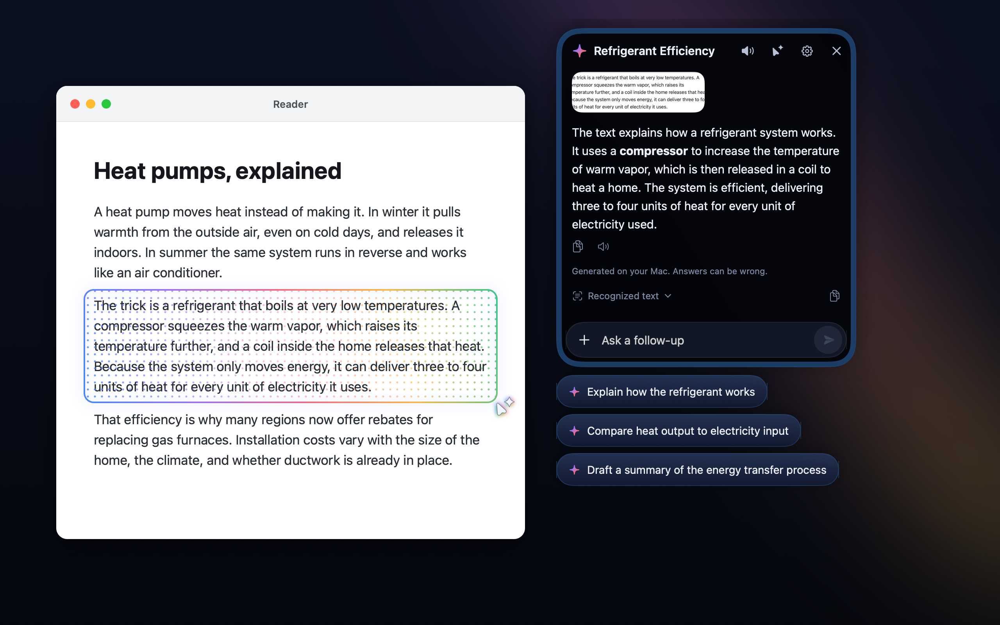
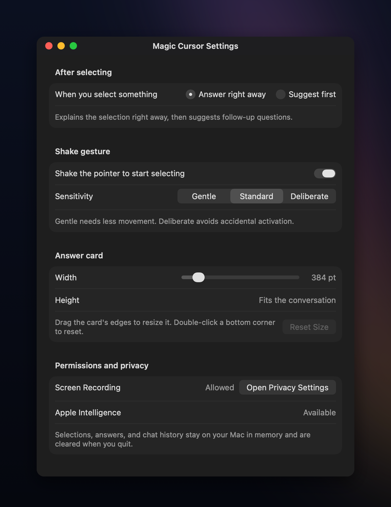

# Magic Cursor for Mac

Shake your pointer, drag over anything on screen, and get an answer right next to it.
Magic Cursor brings the idea behind Googlebook's [Magic Pointer](https://blog.google/products-and-platforms/platforms/android/meet-googlebook/) to the Mac, powered by on-device Apple Intelligence.



## What it does

- Shake the pointer back and forth to start selecting, or pick **Select a screen region** from the menu bar.
- Drag around text, an image, or a chart. Press `Esc` to cancel.
- Read the answer in a floating card that opens next to your selection.
- Tap one of up to three follow-up suggestions written for what you selected, or type your own question.
- Scroll back through every question and answer in the same chat.
- Add up to four selections with **+** and ask about them together.
- Copy any answer or the recognized text, or have an answer read aloud.
- Move the card by dragging it, and resize it from its sides or bottom corners.
- Choose to get an answer right away, or see suggestions first like on Googlebook.

Everything runs on your Mac.
Selections and chats stay in memory and are never uploaded or saved.

## Requirements

- macOS 14 or later, on Apple silicon or Intel
- Screen Recording permission, so the app can read the region you select
- For answers: macOS 26 or later with Apple Intelligence turned on
- For understanding images, not just text: macOS 27 or later

Without Apple Intelligence, Magic Cursor still captures your selection and lets you copy its text.

## Install

1. Download the latest `Magic-Cursor-*.app.zip` from the [Releases page](https://github.com/priyanshu92/mac-magic-cursor/releases/latest).
2. Double-click the zip in Finder to extract it.
3. Drag `Magic Cursor.app` into the Applications folder.
4. Open the app. If macOS blocks it, click **Done**, then open **System Settings > Privacy & Security** and click **Open Anyway**.
5. Click **Allow screen capture** in the assistant panel, or **Open Privacy Settings** in the app's Settings window.
   Both buttons request Screen Recording access first and open macOS settings if access still needs approval.
6. Turn on Magic Cursor under **Privacy & Security > Screen & System Audio Recording**.
   If it is missing from the list, click **+** and select the copy of `Magic Cursor.app` you opened.
   Reopen the app if macOS asks.

If Gatekeeper still blocks the app, run:

```bash
xattr -dr com.apple.quarantine "/Applications/Magic Cursor.app"
open "/Applications/Magic Cursor.app"
```

The app lives in the menu bar, not the Dock.

## Settings

Open **Settings…** from the menu bar icon, or use the gear in the card.
You can turn the shake gesture on or off, change how sensitive it is, choose what happens after you select, and resize the card.



## Development

Building needs Swift 6 and the macOS 27 SDK from Xcode or the Command Line Tools.

```bash
bash scripts/build-app.sh          # build dist/Magic Cursor.app
open "dist/Magic Cursor.app"
```

Run the checks:

```bash
swift run MagicCursorChecks        # gesture, geometry, and parsing logic
bash scripts/check-native.sh       # OCR, chat, modes, and settings
```

Package a universal release zip:

```bash
bash scripts/package.sh
```

## Project structure

```text
Sources/
├── MagicCursorCore/    # Shake detection, selection geometry, card placement, suggestion parsing
└── MagicCursor/        # Menu bar app, selection overlay, floating card, settings, capture and AI
Tests/
├── MagicCursorChecks/        # Checks for the core logic
└── MagicCursorNativeChecks/  # Checks against real Vision OCR and the app model
```

## Built with GitHub Copilot CLI

This app was built entirely with GitHub Copilot CLI.
Its code, checks, documentation, app icon, screenshots, and release packaging were generated by AI under human direction.

## License

Magic Cursor for Mac is available under the [MIT License](LICENSE).
It is an independent project and is not affiliated with Google or Apple.
